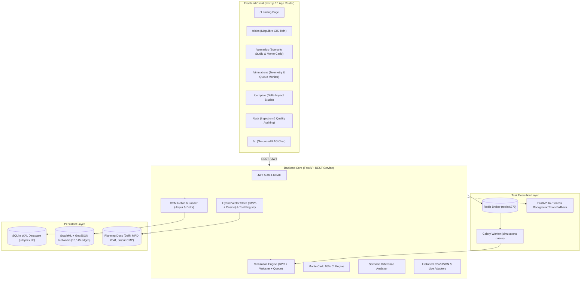

# Urbynex — Multi-City Smart City Digital Twin & Traffic Simulation Platform

[](https://github.com/alokchoudhary885-coder/urbynex/actions)
[](https://fastapi.tiangolo.com)
[](https://nextjs.org)
[](https://python.org)
[](https://docker.com)
[](backend/tests)
[](LICENSE)

> **Urbynex** is a production-grade, multi-city traffic simulation platform and digital twin engine. It enables urban planners and transportation researchers to model real-world road networks, execute BPR-calibrated and Webster signal-controlled simulations, run multi-seed Monte Carlo uncertainty analyses, and query a grounded AI Copilot that adheres to a strict zero-fabrication data policy.

---

## 🏛️ Platform Architecture



---

## 🚀 Key Capabilities

### 1. Real OpenStreetMap Road Networks (Digital Twin)
- **Jaipur MI Road Corridor:** 2,538 nodes, 5,196 edges ingested via OSMnx with single strongly-connected component validation.
- **Delhi Connaught Place Corridor:** 2,887 nodes, 4,949 edges with radial avenues and outer circle topology.
- Interactive MapLibre GL visualization with dynamic edge congestion coloring, hover tooltips, and auto-bounds fitting.

### 2. High-Fidelity Simulation Engine
- **Bureau of Public Roads (BPR) Link-Performance:** Dynamic travel time calculation based on volume-to-capacity ($V/C$) ratios:
  $$t = t_0 \left(1 + \alpha \left(\frac{V}{C}\right)^\beta\right)$$
- **Webster Intersection Signal Timing:** Green-to-cycle ratio calculation minimizing junction control delay:
  $$C_{\text{opt}} = \frac{1.5L + 5}{1 - Y}$$
- **Incident Queue Delay Model:** Shockwave bottleneck progression and capacity degradation along affected road links.

### 3. Stochastic Monte Carlo Uncertainty Analysis
- Multi-seed batch simulation (default 5 seeds) accounting for non-deterministic driver routing and origin-destination variability.
- Automatic computation of **95% Confidence Intervals**, standard deviation, min/max bounds, and mean metrics across the corridor.

### 4. Grounded AI Copilot (RAG Engine)
- Zero-fabrication policy: answers are strictly grounded in indexed municipal planning documentation:
  - *Jaipur Comprehensive Mobility Plan (CMP) 2025*
  - *Delhi Master Plan 2041 (MPD-2041)*
- Hybrid retrieval combining **BM25 keyword search** and **cosine vector embeddings**.
- Approved Tool Registry executing read-only simulation queries (`get_cities`, `get_simulation_metrics`, `compare_scenarios`) with an immutable audit log.

### 5. Data Ingestion & Quality Governance
- Upload and audit historical traffic observations in CSV or JSON format.
- Automated data quality reports: completeness score, valid/invalid row counts, duplicate detection, and outlier rejection.
- Calibrated 24-hour diurnal flow factor profiles for peak-hour expansion.
- Live traffic provider health dashboard with explicit `credentials_missing` transparency.

---

## 📂 Project Structure

```
urbynex/
├── backend/
│   ├── ai/                 # RAG DocumentProcessor, HybridVectorStore, ToolRegistry, CopilotEngine
│   ├── api/                # FastAPI application, routers (cities, scenarios, simulations, copilot, data)
│   ├── auth/               # JWT authentication, password hashing, and user dependencies
│   ├── data/               # OSM road networks (Jaipur, Delhi), adapters, planning documents
│   ├── db/                 # SQLite repository with WAL mode and schema migrations
│   ├── simulation/         # GraphEngine, Webster signal timing, BPR curves, NetworkLoader
│   ├── worker/             # Celery application, task queues, and async dispatch
│   ├── tests/              # 90 automated unit, integration, and E2E acceptance tests
│   ├── Dockerfile          # Python 3.12 production container
│   └── requirements.txt    # Python dependencies
├── frontend/
│   ├── src/
│   │   ├── app/            # Next.js 15 App Router pages (/, /cities, /scenarios, /simulations, /compare, /data, /ai)
│   │   ├── components/     # UI components (NavBar, CityMap, ScenarioBuilder, MetricsDisplay)
│   │   └── lib/api/        # Typed API client and TypeScript schema interfaces
│   ├── Dockerfile          # Node.js production container
│   └── package.json        # Frontend dependencies
├── docs/                   # Engineering specifications, architectural decisions, and API contracts
├── .github/workflows/      # Automated CI/CD pipeline (Pytest, Next.js build, Docker validate)
├── docker-compose.yml      # Multi-container orchestration (Redis, Backend, Celery, Frontend)
└── .env.example            # Environment configuration template
```

---

## ⚡ Quickstart Guide

### Option A: Run with Docker Compose (Recommended)

To launch the full platform (FastAPI backend, Redis, Celery worker, and Next.js frontend):

```bash
# 1. Clone the repository
git clone https://github.com/alokchoudhary885-coder/urbynex.git
cd urbynex

# 2. Configure environment
cp .env.example .env

# 3. Build and launch all services
docker compose up --build
```

- **Frontend Application:** http://localhost:3000
- **FastAPI Interactive Docs:** http://localhost:8000/docs
- **Health Endpoint:** http://localhost:8000/api/health

---

### Option B: Local Development Setup

#### 1. Backend Setup
```bash
# Create virtual environment
python -m venv backend/.venv

# Activate virtual environment
# Windows:
backend\.venv\Scripts\activate
# Linux/macOS:
source backend/.venv/bin/activate

# Install dependencies
pip install -r backend/requirements.txt

# Run test suite (90 tests)
pytest

# Start FastAPI development server
uvicorn backend.api.main:app --reload --port 8000
```

#### 2. Frontend Setup
```bash
cd frontend

# Install Node dependencies
npm install

# Build production bundle
npm run build

# Start Next.js development server
npm run dev
```

---

## 🧪 Testing & Verification

The platform maintains a comprehensive automated test suite with **90 tests** passing:

```bash
& "backend\.venv\Scripts\pytest.exe" -v
```

```
backend/tests/integration/test_acceptance_pipeline.py ...... [  6%]
backend/tests/integration/test_api.py .....................  [ 30%]
backend/tests/integration/test_auth.py ............          [ 43%]
backend/tests/integration/test_worker.py .........           [ 53%]
backend/tests/unit/test_adapters.py ........                 [ 62%]
backend/tests/unit/test_comparison.py ...                    [ 65%]
backend/tests/unit/test_copilot.py .....                     [ 71%]
backend/tests/unit/test_graph_engine.py .........            [ 81%]
backend/tests/unit/test_monte_carlo.py ...                   [ 84%]
backend/tests/unit/test_network_loader.py ......             [ 91%]
backend/tests/unit/test_repository.py ...                    [ 94%]
backend/tests/unit/test_webster.py .....                     [100%]

======================= 90 passed in 24.87s =======================
```

---

## 🛡️ Data Provenance & Ethics

- **Zero-Fabrication Policy:** Urbynex never invents live traffic telemetry or sensor data. If third-party API credentials are not provided, feeds are labeled `credentials_missing`.
- **Traceable Simulation Metrics:** All simulation outputs are marked `SIMULATED` to differentiate synthetic modeling results from measured field observations.
- **Evidence-Grounded AI:** The AI Copilot provides citation badges linking directly to indexed municipal planning publications. Unsubstantiated or out-of-domain queries trigger a transparent `insufficient evidence` notice.

---

## 👤 Author & Maintainer

**Alok Kumar Choudhary**  
- **GitHub:** [@alokchoudhary885-coder](https://github.com/alokchoudhary885-coder)  
- **Portfolio:** [alokchoudhary.vercel.app](https://alokchoudhary.vercel.app)  
- **Contact:** alokchoudhary885@gmail.com  

---

## 📄 License

This project is licensed under the [MIT License](LICENSE).
